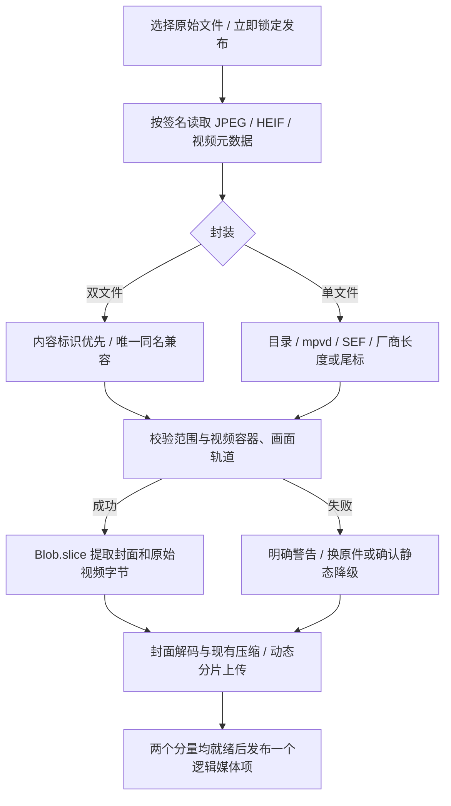

# 多端实况照片

系统在图片压缩前解析实况数据，将不同平台的输入归一为一个封面和一个可选动态视频，继续通过原有图片上传和视频分片上传保存。发布后是一项媒体，时间轴和相册只加载封面；进入灯箱并点击 LIVE 才播放动态。

## 选择文件

- iPhone/iPad：可直接从相册选择照片或视频；能否保留 Live Photo 取决于系统实际交付的资源。网页收到完整单文件或照片与配套 MOV 时会解析并上传；如果系统只交付静态图，网页不能额外读取照片库中的 MOV。已有导出的双资源可用“从文件导入实况原件”一次选入。有 Apple 内容标识时允许文件改名；标识缺失时仅对唯一的同名照片、视频配对。
- 小米、Pixel 和其他 Android：选择相册导出的**实况原件**。标准单文件会自动拆出封面和内嵌视频，不需要预先转换为视频。
- 系统文件选择器、聊天软件或相册分享若只交付静态图，网页无法还原缺失视频。普通静态图正常上传；原图含实况标记却缺少视频时，会说明原因，并提供“重新选择原件”或“仅保留静态图”。
- 缺失动态、解析错误及图片/视频失败都会阻止发布。动态可重试或重选原件续传，封面成功后也可明确选择仅保留静态图。多个同名候选或标识冲突保持独立，避免误配。

## Web / H5 / PWA 的选择配置

当前项目使用 React Web，没有原生照片库权限或 WebView 桥接。所有平台共用相同入口，不根据 iPad 的桌面 UA 或屏幕宽度猜测系统能力：

```html
<!-- 相册入口：只声明照片/视频，不设置 capture。 -->
<input type="file" accept="image/*,video/*" multiple>

<!-- 独立拍照入口：仅用于用户明确要求调用相机。 -->
<input type="file" accept="image/*" capture="environment">

<!-- 已有双资源的导入入口：保留原件扩展名过滤，兼容空 MIME 文件。 -->
<input type="file" accept="image/*,video/*,.heic,.heif,.avif,.mov,.mp4" multiple>
```

实际实现位于 `frontend/src/features/composer/ComposerDialog.tsx`：按钮在用户点击事件内同步调用对应 input 的 `click()`；`addPickedFiles()` 先复制 FileList、再清空 input，允许取消后继续操作和重复选择同一文件；三个入口均调用既有 `service.addFiles()`，先读取、再解析配对、最后处理上传。

`accept` 是文件类型提示，不是照片库专用 API。删除扩展名只是让主入口的媒体过滤更明确，**不保证隐藏**“照片图库 / 拍摄照片或视频 / 选择文件”或第三方提供器。WebKit 的文件上传面板会根据媒体类型、设备及 capture 配置决定菜单；`capture="environment"` 指向相机，不能用于强制打开相册，`capture="false"` 也不等于移除该属性。`showPicker()` 或 `click()` 仍调用浏览器的选择器，不会授予网页 PhotoKit 权限。

浏览器返回转码后的静态 JPEG 且未携带实况标识时，网页无法可靠区分它与普通静态照片。不能据此承诺动态已保留，也不能把所有普通图片都当成“缺 MOV”。已识别的缺动态与配对冲突继续要求处理，不能静默发布为完整实况。

## 原生 Swift / SwiftUI / WebView 参考

下列为原生宿主参考片段，未在本仓库接入、编译或真机验证。纯 Web/PWA 不执行这些 API。

使用 `PHPickerViewController` 直接展示照片库，不先展示文件来源菜单。普通照片、实况与视频共用时使用 `.any(of: [.images, .videos])`；只允许实况时改为 `.livePhotos`。SwiftUI 可用 `UIViewControllerRepresentable` 包装这个控制器。

```swift
import Photos
import PhotosUI

@MainActor
func makeMediaPicker(delegate: any PHPickerViewControllerDelegate) -> PHPickerViewController {
    var configuration = PHPickerConfiguration()
    configuration.filter = .any(of: [.images, .videos])
    configuration.selectionLimit = 0
    configuration.preferredAssetRepresentationMode = .current
    let picker = PHPickerViewController(configuration: configuration)
    picker.delegate = delegate
    return picker
}
```

宿主持有 delegate，并在 `picker(_:didFinishPicking:)` 中处理空结果（取消）。对实况检查 `itemProvider.canLoadObject(ofClass: PHLivePhoto.self)`，然后通过 `loadObject(ofClass: PHLivePhoto.self)` 取得 PHLivePhoto；不要只加载 UIImage。Apple 提供 `PHAssetResource.assetResources(for: livePhoto)`，可从这份选中对象取得照片与 pairedVideo，不必为了导出选中项而先取得全库权限或依赖 `assetIdentifier`。

```swift
enum LivePhotoExportError: Error {
    case missingPair
}

// directory 由调用者在应用沙盒创建为本次专用目录，失败后由调用者清理。
@MainActor
func exportLivePhoto(_ livePhoto: PHLivePhoto, to directory: URL) async throws -> [URL] {
    let resources = PHAssetResource.assetResources(for: livePhoto)
    let photos = resources.filter { $0.type == .photo }
    let videos = resources.filter { $0.type == .pairedVideo }
    guard photos.count == 1, videos.count == 1 else {
        throw LivePhotoExportError.missingPair
    }
    let options = PHAssetResourceRequestOptions()
    options.isNetworkAccessAllowed = true
    var urls: [URL] = []
    for resource in [photos[0], videos[0]] {
        try Task.checkCancellation()
        let url = directory.appendingPathComponent(resource.originalFilename)
        try await withCheckedThrowingContinuation { (continuation: CheckedContinuation<Void, any Error>) in
            PHAssetResourceManager.default().writeData(for: resource, toFile: url, options: options) { error in
                if let error {
                    continuation.resume(throwing: error)
                } else {
                    continuation.resume(returning: ())
                }
            }
        }
        urls.append(url)
    }
    try Task.checkCancellation()
    return urls
}
```

- `.current` 避免要求系统兼容性转码，但不等于自动获得原件归档。照片和 MOV 均应按原始字节保存，保留内容配对标识、MIME、原始文件名和两者的关联；展示副本另行生成。当前博客的图片转换/视频处理属于展示上传，不承诺原件级回导。
- iCloud 资源应显示下载进度、网络失败和取消状态。上述简化导出片段在写入之间检查取消；生产宿主还需管理在途请求、后台任务、失败后的部分文件清理和完成状态。回调不保证在主线程，更新 UI 要回 MainActor。
- 若改用 `PHAsset.fetchAssets` 获取图库资产，必须另行处理 PhotoKit 读权限、limited 状态和 Info.plist 用途说明；仅使用 PHPicker 不代表获得全库读取权限。原始 `.photo/.pairedVideo` 与编辑后的 fullSize 资源不能随意混搭。
- 若使用 `loadFileRepresentation`，必须在 completion handler 返回前复制其临时文件到沙盒，再上传。
- WKWebView 需要宿主用原生照片选择器接管并将实际双资源交给上传层；浏览器/PWA 没有这层桥接。Android 原生宿主可使用 AndroidX 的 `PickMultipleVisualMedia`，但仍需检查照片提供器是否交付 Motion Photo 原始字节，不能保证所有厂商都相同。

权威依据（HTML 类型提示、WebKit 菜单实现、Apple 选择器与底层资源 API、Android Photo Picker）：

```text
https://html.spec.whatwg.org/multipage/input.html#attr-input-accept
https://w3c.github.io/html-media-capture/#the-capture-attribute
https://github.com/WebKit/WebKit/blob/main/Source/WebKit/UIProcess/ios/forms/WKFileUploadPanel.mm
https://developer.apple.com/videos/play/wwdc2020/10652/
https://developer.apple.com/documentation/photos/phassetresource/assetresources(for:)-2fedw
https://developer.apple.com/documentation/photos/phassetresourcemanager/writedata(for:tofile:options:completionhandler:)
https://developer.android.com/training/data-storage/shared/photo-picker
```

## 格式覆盖与验证范围

兼容按文件结构判断，不以品牌、扩展名或浏览器 UA 代替解析。下表中的结构覆盖不等于已经完成所有系统版本和真机测试。

| 来源/封装 | 实现 | 本次证据 |
|---|---|---|
| iOS HEIC/HEIF/JPEG + MOV/MP4 | EXIF Apple MakerNote `0x0011` 与 QuickTime `com.apple.quicktime.content.identifier` 优先配对；缺失标识才使用无歧义同名主干 | 合成 Apple JPEG/HEIC 元数据、真实编码视频；Chrome 改名配对、发布及刷新恢复通过；iPhone 真机选择器尚待验证 |
| Xiaomi/HyperOS 的 Google 兼容布局 | 旧 `MicroVideoOffset`，新 Container Directory，Padding、GainMap | 两种布局、辅助图、填充与冲突字段的结构样本通过；尚无小米真机原片 |
| Pixel / 通用 Android JPEG | Container Directory、旧 MicroVideo、完整扩展 XMP；保留 JPEG 后、视频前的厂商辅助数据 | AndroidX 完整 Pixel 原件通过，提取视频 SHA-256 与上游独立 MP4 完全一致，FFprobe 确认两条 HEVC 轨道；缩短 Pixel 样本结构通过 |
| Android HEIC/AVIF Motion Photo | HEIF 元数据 `iinf/iloc`、文件尾 `mpvd`（8/16 字节头），目录存在时交叉核验 | AndroidX `sample_MP.heic` 通过解析、FFprobe 和 Chrome 封面转换/动态上传；普通 HEIC 不误判。AVIF 容器走相同路径，尚无原始实况样本 |
| Samsung SEF | 解析 SEFH/SEFT 目录和 `MotionPhoto_Data`；兼容 `mpv2` 大端绝对偏移/长度，剥离 SEF 尾部 | 直接数据和指针两种结构样本通过；AndroidX 缩短 Samsung 样本的 SEF 指针超过文件大小，按损坏数据拒绝，不能当作完整真机原件证据 |
| OPPO/OnePlus/realme 的 Oplus 布局 | 标准目录与 `http://ns.oplus.com/photos/1.0/camera/` 下 `VideoLength`；实际视频长度可小于目录长度 | 结构样本覆盖视频后 336 字节私有数据，提取不包含该尾部；真机原片尚待验证 |
| vivo 的标准兼容布局 | 标准目录、完整图片后 `cameralbum!` 与有效 MP4；合法 `uuid` box 保留在视频内 | 标准结构和前缀样本通过，尚无真机原片；未实现无可靠来源的所谓 vivo `MediaDataOffset` 公式 |
| 华为/荣耀已知 LIVE 尾标 | JPEG/HEIC + 视频 + 60 字节尾标，`videoLength = LIVE_值 - 20` | JPEG/HEIC 结构样本通过；新系统及其他尾标变体尚待真机原片验证 |
| 无厂商标记的尾附 MP4 | 仅在完整静态容器之外尝试，最终必须有完整视频 box 链和画面轨道 | 结构样本通过，输出 `RECOVERED_MOTION` 提示；不在像素或 EXIF 内盲搜 `ftyp` |

## 统一接口

实现位于 `frontend/src/native/live-photo.js`，不依赖 DOM，可由浏览器和 Node 24 导入。基础二进制读取位于 `frontend/src/native/live-photo-binary.js`；未新增 npm、WASM 或系统依赖。以下导入路径按项目根目录中的 Node 脚本示例，前端按所在模块使用相对路径，由 Vite 打包。

```js
import {
  inspectLivePhoto,
  extractLivePhoto,
  normalizeMediaFiles,
} from './frontend/src/native/live-photo.js'

const controller = new AbortController()
const inspection = await inspectLivePhoto(file, { signal: controller.signal })
const media = await extractLivePhoto(file, inspection, { signal: controller.signal })

// 实际上传入口使用批量接口，才能识别同一次选择中的 iOS 双文件。
const items = await normalizeMediaFiles(input.files, {
  signal: controller.signal,
  onProgress: ({ completed, total }) => console.log(completed, total),
})
```

Node 使用项目相对路径导入同一模块；输入是内置 `File`/`Blob`。`extractLivePhoto` 只复用同一文件对象对应的 inspection；不匹配时重新检查。取消会抛出 AbortError；单个文件的格式/内容错误则进入 `warnings`，不会吞掉批次其他文件。

```js
{
  kind: 'live',                 // 'image' | 'video' | 'live'
  original: File,                // 当前原件引用，不序列化到草稿 JSON
  still: File,                  // 图片或实况封面；普通视频时为 null
  motion: File,                 // 实况动态；普通媒体时为 null
  video: null,                  // 普通视频时为 File
  source: {
    format: 'android-container',
    originalName: 'MVIMG.jpg',
    pairing: 'embedded',         // 'identifier' | 'filename' | 'embedded' | null
    motionRange: { start, length, type: 'video/mp4' },
  },
  warnings: [
    { code, message, recoverable: true, blocking: true },
  ],
}
```

双文件的 `motionRange` 为 null，`pairing` 说明配对依据。顺序按该逻辑项最早出现的位置，每个输入文件最多消费一次；同一 File 引用重复提供不会重复输出。明确 `MotionPhoto=0`（或无新版字段时 `MicroVideo=0`）的文件保持静态，不参加后续同名配对。

`blocking` 警告要求用户处理；非阻断警告只说明恢复方法、重复候选或冲突。`recoverable` 表示可以尝试换原件或保留可解码静态部分，不保证损坏图片能解码。

## 核心流程



1. **检测先于重编码。** XMP、EXIF、文件名和原始偏移在 HEIC 转 JPEG、Canvas 压缩和改名前读取，避免动态分量先被压缩删除。
2. **目录定位。** 从文件末尾反推次级项目；检查主图结束之前不能出现视频，保留 GainMap、填充及主图剩余区域。`Primary.Length=0` 的剩余区域可能包含 Pixel `aecDebug`，不能强制等于第一个 JPEG EOI。
3. **元数据合并。** XMP 按命名空间解析属性/元素写法，不依赖 `GCamera` 等固定前缀。扩展 XMP 关联 GUID、总长度和分片区间必须一致完整；冲突、缺片、重叠或越界直接报告。GUID 用于关联，不将其当作密码学完整性认证。
4. **视频验证。** 校验安全整数范围、box 边界、FTYP 与非空 MDAT，以及 MOOV 中的画面轨道；允许带初始化信息的碎片 MP4。仅有 `ftyp` 字符串或 HEIC 图片容器不能充当动态视频。浏览器结构检查不能替代解码；上传后继续由现有服务端 FFprobe 和视频管线验证。
5. **提取。** `Blob.slice()` 保留视频字节，不在解析阶段转码。封面是保持原始坐标关系的前缀；HEIF `mpvd` 目前要求唯一且位于文件尾，避免移除中间 box 破坏其他 item 的绝对偏移。
6. **处理与上传。** `frontend/src/features/composer/image-processing.js` 先尝试浏览器原生 HEIC 主图解码，失败再使用既有本地 heic2any。验证可解码后沿用图片压缩策略；AVIF 等服务器不接收的封面转 JPEG。视频使用现有上传/转码策略，`needsPoster=false`，不再为实况视频生成另一张封面。
7. **引用与发布。** 图片仍通过 `POST /api/uploads`，动态仍通过 `/api/uploads/video/*` 分片和查询。发布 JSON 仍为 `images: [{ filename, motion }]`。后端校验草稿/用户归属、已采用视频版本，以及实况主文件必须是图片；不改变数据库结构。

此处“封装”指标准化上传描述及一个逻辑媒体项，不生成 Apple 相册可导入的双文件包，不写回厂商格式，也不接收 ZIP。提取封面阶段保留必要辅助图；后续 Canvas/heic2any 与视频转码仍可能是有损或 HDR 转 SDR，不能称为原件无损保存或跨平台相册互认。

## 草稿、失败与清理

- 草稿 JSON 记录来源、配对方式、警告/待确认状态，以及既有视频任务 ID、客户端 ID 和指纹；不存大视频字节。
- 照片原件在 IndexedDB 中暂存。封面与动态完成、或用户明确仅保留静态图后回收；浏览器存储被禁用、配额不足或缓存被清空时，改为要求重选原件。
- 未完成的内嵌视频可以重新选择同一张原始实况照片，再次解析提取后按**视频字节**的原指纹续传。错误原件会被拒绝，不能通过重新初始化覆盖旧任务。已完整接收的任务沿用后台恢复。
- 解析期间、草稿恢复期间、媒体失败或存在待确认警告时禁用发布。草稿查询失败会保留浏览器原有记录、继续阻止发布，重新打开后可再恢复；不得把图片错误或未恢复项当作可忽略内容。
- 动态失败可重试/续传，或在封面就绪后点击“仅保留静态图”。降级先取消动态任务并回收无引用文件，失败则保留错误和操作入口；清理失败原因会显示。
- 移除/关闭会停止相应页面任务；移除期间晚到的上传结果会回收，不重新加入预览。关闭编辑器仍保留服务器草稿/任务，供重开恢复。
- 本地与 WebDAV 继续使用已有 `storage_path` 和三列引用检查。发布、撤图、丢弃、删除动态均覆盖封面、motion 和视频候选；无新增独立媒体行。

| 主要错误码 | 含义与操作 |
|---|---|
| `MISSING_MOTION` / `MISSING_PAIRED_VIDEO` | 实况标记存在但缺完整视频，选择原件或明确静态降级 |
| `INVALID_RANGE` | 长度超限、指针越界或分量重叠，不能按声明范围提取 |
| `INVALID_METADATA` | EXIF/XMP/SEF 不完整、循环、冲突或关联异常 |
| `INVALID_CONTAINER` / `INVALID_VIDEO` | box 链、初始化信息或画面轨道无效，服务端还会验证真实媒体 |
| `INVALID_IMAGE` | JPEG 边界或辅助图异常；封面解码仍可能进一步失败 |
| `UNSUPPORTED_LAYOUT` / `UNSUPPORTED_FORMAT` | 未覆盖的私有布局或文件类型，显示原因，不伪造动态结果 |
| `RESOURCE_LIMIT` | 解析预算超限，可换原件或确认静态降级 |
| `AMBIGUOUS_PAIR` / `PAIR_ID_CONFLICT` | 保持独立文件，不任选第一对 |
| `RECOVERED_MOTION` / `UNKNOWN_TRAILER` | 前者是通过结构恢复视频的非阻断说明；后者需确认未知尾部如何处理 |

资源上限：总读取 32MiB、单段读取 2MiB、XMP/扩展 XMP 各 512KiB、8192 个 box、XML 深度 32、4096 个 XML 节点、128 个属性/节点、EXIF 2048 个目录条目及深度 8、HEIF 2048 个定位项目。顺序解析文件，跳过大 MDAT 内容。拒绝 DTD/实体声明，不访问外部实体。超过限制明确告知，不能把资源上限错误写成“普通图片”。

## 实现与验证入口

- `frontend/src/native/live-photo-binary.js`：有界 Reader、EXIF/Apple 标识、JPEG 与扩展 XMP、HEIF item、BMFF 与视频轨道验证。
- `frontend/src/native/live-photo.js`：格式适配、统一检测/提取、标识优先批量配对和结构化警告。
- `frontend/src/features/composer/composer-service.js` 与 `image-processing.js`：选文件读取、解析、主图转换、既有上传接入、待确认/降级、原照片续传与草稿恢复；选择入口由 `ComposerDialog.tsx` 渲染。
- `server/routes/posts.js` 与 `server/services/media.js`：发布组合与归属校验；其他视频、存储和数据库模块保持原有职责。
- `tests/media-regression.mjs`：正式回归增加内嵌视频字节提取、缺失分量、歧义配对和非法发布组合断言。测试收尾先停止后台视频任务再关闭数据库。

验证记录更新于 2026-10-20：基础解析专项和 23 组补充边界检查通过（包括扩展长度 box、带初始化信息的碎片 MP4、扩展 XMP 缺片/重叠、显式关闭配对、循环 EXIF 及资源上限）。五项既有回归通过，stderr 为空。独立 `npm start` 与 curl 完成登录、建草稿、封面/动态上传、单项实况发布、读取、Range 206、私密鉴权和删除回收；隔离 WebDAV 完成相同存储链路并确认无剩余文件和 pending_uploads。

实际 Chrome 完成单文件上传发布、LIVE 点击播放/关闭、Apple 改名配对、草稿刷新、静态降级、缺失动态确认、解析取消、动态失败重试、重选照片的错误指纹拒绝与正确续传，以及公开 HEIC 封面转换和动态上传。补测封面保存失败后的刷新恢复、取消失败阻止降级/重试、移除时迟到上传文件回收、损坏 HEIC、草稿读取失败不覆盖原状态。360px 实际页面截图，以及 390px/1280px 明暗布局断言通过；按钮至少 44px、无横向溢出、可滚动触达，未捕获未处理页面错误。上述浏览器模拟不代替真机文件选择器、键盘和编码支持测试。

公开样本来自 AndroidX Media3 的 `libraries/test_data/src/test/assets/media/`：`jpeg/pixel-motion-photo-2-hevc-tracks.jpg`、对应 `mp4/pixel-motion-photo-2-hevc-tracks.mp4`、`jpeg/pixel-motion-photo-shortened.jpg`、`heif/sample_MP.heic`、`heif/sample_still_photo.heic`；Samsung 的 shortened 样本仅验证损坏指针拒绝。样本不加入生产资源或仓库，测试完成清理。

仍需覆盖：iOS/各 Android 厂商真机文件选择器及不同分享渠道、未获得原片的厂商私有变体、真实 WebDAV 服务和生产代理环境。当前浏览器/设备不支持最终选定视频编码时，播放仍会提示不支持，解析层不承诺所有设备解码所有 HEVC/HDR 原件。

## 格式依据

以下为原始规范和参考实现的定位地址；本项目代码按所需格式独立实现，不复制其运行时依赖。

```text
Android Motion Photo 官方规范：
https://developer.android.com/media/platform/motion-photo-format
AndroidX Media3 参考解析与测试素材：
https://github.com/androidx/media/tree/release/libraries/extractor/src/main/java/androidx/media3/extractor/jpeg
https://github.com/androidx/media/tree/release/libraries/test_data/src/test/assets/media
Apple MakerNote 与 QuickTime 字段（ExifTool）：
https://github.com/exiftool/exiftool/blob/master/lib/Image/ExifTool/Apple.pm
https://github.com/exiftool/exiftool/blob/master/lib/Image/ExifTool/MakerNotes.pm
https://github.com/exiftool/exiftool/blob/master/lib/Image/ExifTool/QuickTime.pm
Samsung SEF（ExifTool ProcessSamsung / EmbeddedVideoOffsetSize）：
https://github.com/exiftool/exiftool/blob/master/lib/Image/ExifTool/Samsung.pm
Oplus VideoLength 与目录布局：
https://github.com/lenuxo/oppo-live-pic-tool/blob/main/src/core/inspect.ts
华为/荣耀 LIVE 尾标读写实现：
https://github.com/LengxiQwQ/live-photo-box/blob/master/LivePhotoBox.Core/Services/Protocols/HuaweiMovingPhotoProtocol.cs
```
